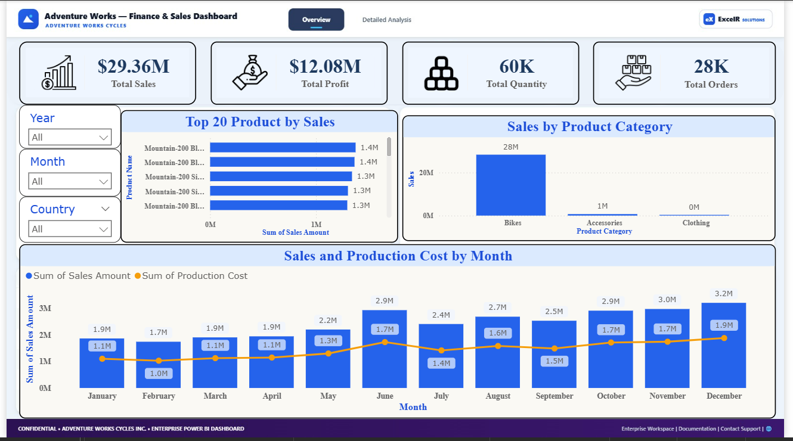
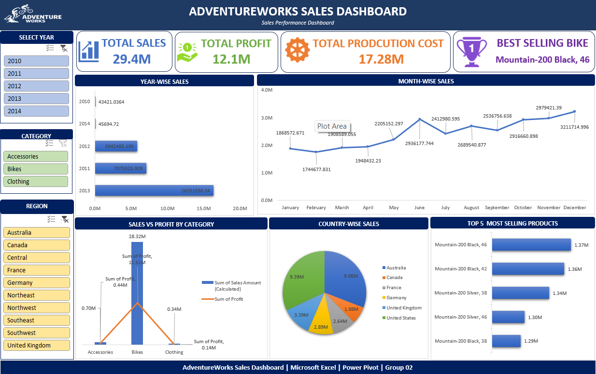
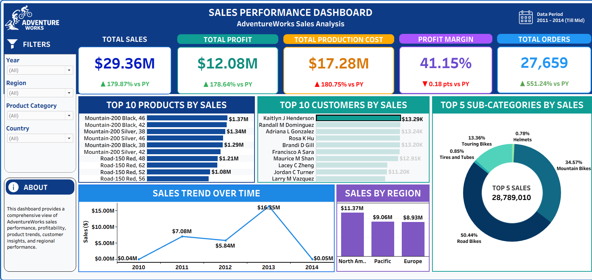
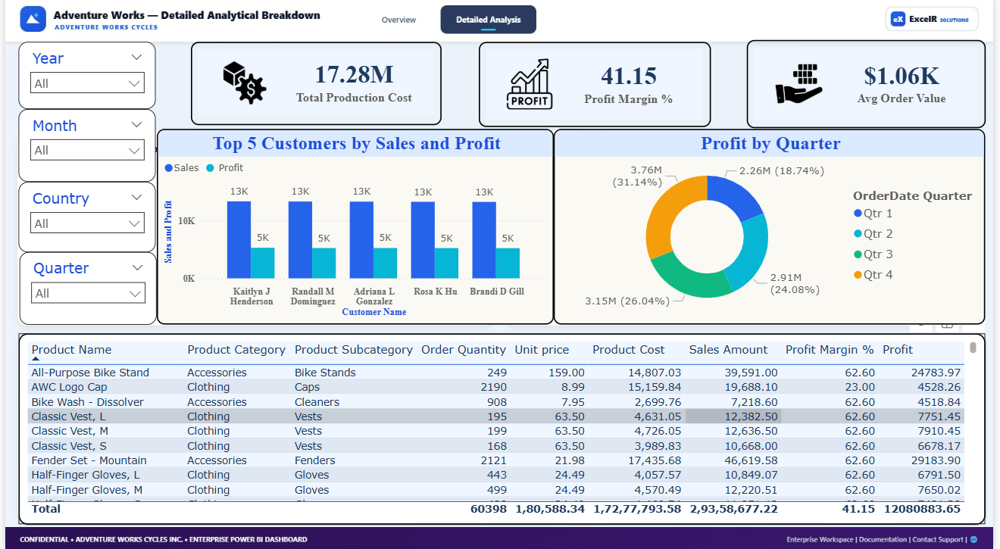

# AdventureWorks Sales Analytics (Excel · SQL · Power BI · Tableau)

An end-to-end sales analysis of **Adventure Works Cycles**, Microsoft's fictional bicycle manufacturer. It covers **60,398 order lines, 27,659 orders and 18,484 customers** from Dec 2010 to Jan 2014. Two raw sales tables are combined, enriched with product, customer, date and territory data, and turned into KPIs and dashboards in four tools. The project is organised around 13 business questions (`docs/Project_Questions.xlsx`).



---

## Headline results

| KPI | Value |
|---|---|
| Total sales | **$29.36M** |
| Total production cost | **$17.28M** |
| Total profit | **$12.08M** |
| Profit margin | **41.15%** |
| Total orders | **27,659** |
| Units sold | 60,398 |
| Average order value | **$1,061.45** |

## Key insights

1. **2013 was the breakout year.** Sales reached $16.35M, more than double 2011 ($7.08M) and 2012 ($5.84M). 2010 and 2014 hold only a few days or weeks of data, so they are not comparable full years.
2. **Bikes are the business.** Road, Mountain and Touring bikes bring in $28.3M of the $29.36M, about 96%. Accessories and clothing sell in volume but add little revenue.
3. **The Mountain-200 range leads the product list.** Mountain-200 Black 46, Black 42 and Silver 38 are the top 3 products, each around $1.34–1.37M.
4. **Australia is the single biggest region** ($9.06M). North America is the biggest market group overall ($11.37M), led by the US Southwest ($5.72M).

---

## What's in this folder

| Folder | Contents |
|---|---|
| `data/` | All source tables: `FactInternetSales`, `Fact_Internet_Sales_New`, `DimCustomer`, `DimProduct`, `DimProductCategory`, `DimProductSubCategory`, `DimDate`, `DimSalesTerritory` |
| `sql/` | `adventureworks_sales_analysis.sql`: Q0–Q13 in MySQL (UNION view, LEFT JOIN lookups, date breakdowns with CTEs, calculated columns, pivots, `DENSE_RANK()` customer ranking, reporting views) |
| `excel/` | Power Query solution for every question + PivotTable dashboard with slicers |
| `powerbi/` | `.pbix`: one page per question (Q1–Q12), KPI cards, an overview dashboard and a detailed-analysis page |
| `tableau/` | `.twbx`: 23 worksheets, a main dashboard and a KPI dashboard with year-on-year growth indicators |
| `presentation/` | Final project deck (PDF for viewing, PPTX for editing) |
| `docs/` | Project brief and the 13 business questions |
| `images/` | Dashboard screenshots |

## Data model

```
DimCustomer ──┐                 ┌── DimProduct ── DimProductSubCategory ── DimProductCategory
              │                 │
              └── Master Sales ─┤   (FactInternetSales  UNION ALL  Fact_Internet_Sales_New)
                                │
DimDate ────────────────────────┴── DimSalesTerritory
```

## Business questions answered

| # | Question | Technique |
|---|---|---|
| Q0 | Combine both sales tables | `UNION ALL` into a view / Power Query Append |
| Q1–Q2 | Look up product name, unit cost and customer full name | `LEFT JOIN`, `CONCAT` / Merge Queries |
| Q3 | Break the order date into Year, Month, Quarter, Year-Month, Weekday and Financial Month/Quarter | `STR_TO_DATE` + date functions in a CTE |
| Q4–Q6 | Sales amount, production cost, profit | Calculated columns |
| Q7–Q11 | Month-wise, year-wise and quarter-wise sales; sales vs cost | Pivot, bar, line, pie and combo charts |
| Q12 | Top products and categories, top customers, region performance | `GROUP BY`, `DENSE_RANK() OVER (…)` |
| Q13 | Executive reporting | SQL views: `ExecutiveKPI`, `TerritoryPerformance`, `ProductPerformance` |

## Dashboards

| Excel | Tableau |
|---|---|
|  |  |

Power BI detailed analysis page:



## Tools
MySQL · Excel (Power Query, Power Pivot, PivotTables) · Power BI (DAX, data modelling) · Tableau (calculated fields, current-vs-previous-year growth KPIs)

---

*Data: Microsoft AdventureWorks sample data (public).*
